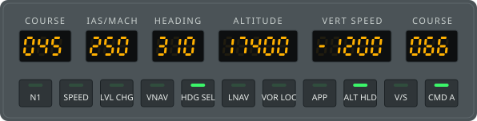
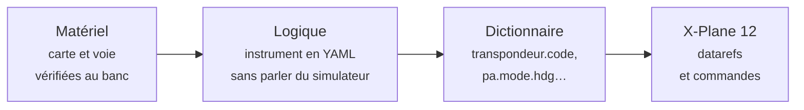

---
hide:
  - navigation
  - toc
---

<div class="pepit-hero" markdown>

<div markdown>

# Pepit

<p class="pepit-hero__lede">Le SIOC libre pour Linux : vos cartes OpenCockpits, EFDE et Arduino, reliées à X-Plane 12, sans plugin. Le cockpit se décrit en YAML.</p>

<div class="pepit-hero__buttons" markdown>
[Installer](demarrage/installation.md){ .md-button .md-button--primary }
[Premiers pas](demarrage/premiers-pas.md){ .md-button }
[GitHub](https://github.com/pierrezNet/pepit){ .md-button }
</div>

<ul class="pepit-hero__tags">
<li>Linux</li><li>X-Plane 12</li><li>OpenCockpits</li><li>EFDE</li><li>Arduino / ESP</li><li>GPL-3.0</li>
</ul>

</div>

<div class="pepit-hero__panel">

</div>

</div>

## Ce que fait Pepit

<div class="grid cards" markdown>

-   :material-usb-port:{ .lg .middle } **Vos cartes, reconnues**

    ---

    OpenCockpits, EFDE, manettes Thrustmaster : détectées à leur branchement, sans pilote à installer, vérifiées entrée par entrée au banc de test, et leur accès ouvert d'un clic.

    [:octicons-arrow-right-24: Cartes prises en charge](materiel/cartes.md)

-   :material-airplane-takeoff:{ .lg .middle } **Reliées à X-Plane 12**

    ---

    MCP, CDU et son écran, radio, transpondeur, jauges, manettes des gaz : profils complets du BAe 146 et du Boeing 737-800, choisis selon l'avion chargé. X-Plane se lance d'un clic.

    [:octicons-arrow-right-24: La page Simulateur](utilisation/cockpit.md)

-   :material-wifi:{ .lg .middle } **Cartes wifi de SIOC**

    ---

    Les cartes Arduino et ESP écrites pour SIOC se connectent à Pepit comme à SIOC (protocole IOCP) : afficheurs, écran à encre.

    [:octicons-arrow-right-24: Cartes wifi](materiel/cartes-wifi.md)

-   :material-file-cog-outline:{ .lg .middle } **Un cockpit en YAML**

    ---

    Sélecteurs, encodeurs, voyants, jauges : chaque pièce se décrit en quelques lignes, avec des noms de fonctions lisibles.

    [:octicons-arrow-right-24: Types de commandes](configuration/types.md)

</div>

## Trois couches, une méthode

Chaque pièce du cockpit suit le même chemin. Changer d'avion, ou un jour de simulateur, ne touche que la dernière étape.



[:octicons-arrow-right-24: Le dictionnaire des fonctions](configuration/dictionnaire.md)

## Démarrer en trois commandes

<div class="pepit-steps" markdown>

1.  **Voir les cartes branchées**

    ```sh
    bin/pepit list
    ```

2.  **Les tester au banc** : chaque entrée s'allume quand on l'actionne, chaque sortie se commande.

    ```sh
    bin/pepit-cartes
    ```

3.  **Lancer le cockpit**, puis X-Plane d'un clic depuis la page Simulateur :

    ```sh
    bin/pepit-simulateur config/avions/bae146-jf
    ```

</div>

## Deux façons de s'en servir

**Clé en main.** Vous avez le même matériel et le même avion qu'un profil existant : branchez, installez, lancez. Les profils du [BAe 146](avions/bae146.md) et du [Boeing 737-800](avions/b737.md) relient déjà le MCP, le CDU, la radio, le transpondeur, les jauges et les manettes.

**Une méthode pour votre cockpit.** Votre matériel ou votre avion sont différents : les [premiers pas](demarrage/premiers-pas.md) montrent le chemin d'une pièce, du banc de test jusqu'à X-Plane, et chaque profil existant sert de modèle.

!!! note "État du projet"
    Pepit tourne sur un cockpit réel, mais reste un projet personnel. Les protocoles ont été retrouvés sur du matériel réel ou communiqués par les fabricants. Pepit n'est affilié ni à OpenCockpits, ni à EFDE, ni à Laminar Research.
